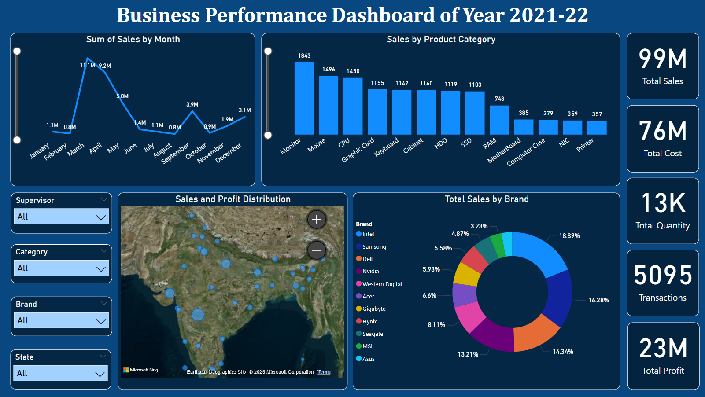

# Business Performance Sales Dashboard – Power BI

## Project Objective

The objective of this project is to analyze business sales performance across different product categories, brands, states, and supervisors.

The dashboard provides an interactive view of sales, cost, profit, quantity, and transaction performance, helping users explore business performance and derive meaningful insights from sales data.

---

## Dataset Used

The project uses a structured transactional sales dataset for business performance analysis.

* **Main dataset:** `Sales_Data`
* **Supporting datasets:** `State_List`, `Supervisor`
* **Dataset type:** Structured transactional sales data
* **Format:** Microsoft Excel (`.xlsx`)
* **Data source:** Excel dataset obtained from a YouTube tutorial/video

### Main Columns

The `Sales_Data` table contains:

* Order Number
* Order Date
* Customer Name
* State Code
* Product
* Category
* Brand
* Sales
* Cost
* Quantity
* Total Sales
* Total Cost
* Assigned Supervisor
* Order Status

The supporting `State_List` table contains state and state-code information, while the `Supervisor` table contains supervisor information and image URLs.

---

## Business Questions / KPIs

The dashboard focuses on the following business questions:

* What is the total sales and cost generated?
* What is the overall profit?
* How many products were sold?
* How many transactions were recorded?
* How do sales change over time?
* Which categories have the highest sales quantity?
* Which brands contribute the most to total sales?
* How does sales performance vary across states?
* How does business performance vary when filtered by supervisor, category, brand, and state?

### Key Performance Indicators

* **Total Sales**
* **Total Cost**
* **Total Profit**
* **Total Quantity**
* **Total Transactions**

---

## Process / Methodology

1. Imported the Excel dataset into Power BI.
2. Prepared and transformed the data using Power Query.
3. Promoted headers and assigned appropriate data types.
4. Removed blank rows from the main sales dataset.
5. Created a data model using:

   * `Sales_Data` as the main fact table.
   * `State_List` as a state dimension.
   * `Supervisor` as a supervisor dimension.
6. Created one-to-many relationships between the tables.
7. Created DAX measures for key business KPIs.
8. Created a custom `Total Profit` measure using `SUMX`.
9. Designed interactive charts, KPI cards, map visualization, and slicers.
10. Built the final business performance dashboard.

### DAX Measure

The dashboard uses the following DAX measure to calculate total profit:

```DAX
Total_Profit =
SUMX(
    Sales_Data,
    [Total_Sales] - Sales_Data[Total_Cost]
)
```

---

## Dashboard Overview

The dashboard provides a single-page view of business performance through:

* **KPI Cards:** Total Sales, Total Cost, Total Quantity, Total Transactions, and Total Profit
* **Monthly Sales Trend:** Total Sales by Month using a line chart
* **Category Analysis:** Quantity sold by Product Category using a bar chart
* **Brand Analysis:** Total Sales by Brand with Total Profit available in tooltips
* **State-wise Analysis:** Sales distribution across states using a map with Sales, Profit, and Quantity tooltips
* **Interactive Slicers:** Supervisor, Category, Brand, and State

### Dashboard Preview



---

## Project Highlights

* **Total Sales reached 99M**, with **23M Total Profit** generated across **5,095 transactions**.
* **March recorded the highest monthly sales at 11.1M**, followed by April at 9.2M.
* **Monitor recorded the highest quantity sold at 1,843 units**, followed by Mouse (1,496) and CPU (1,450).
* **Intel contributed the largest share of total sales at 18.89%**, followed by Samsung (16.28%) and Dell (14.34%).
* The dashboard provides a geographical view of sales distribution across states.
* Interactive slicers allow users to dynamically explore performance across different business segments.

---

## Final Conclusion

This project demonstrates how raw sales data can be transformed into an interactive **Business Performance Dashboard** using Power BI. The dashboard provides a consolidated view of sales, cost, profit, product demand, brand contribution, monthly trends, and state-wise performance. With **Power Query, DAX, data modeling, and interactive visualizations**, the project highlights how business data can be analyzed and presented to support informed, data-driven decision-making.

---

## Tools Used

* Microsoft Power BI
* Power Query
* DAX
* Microsoft Excel
* Data Modeling
* Data Visualization

---

## Author

**Apurva Deshmukh**

Aspiring Software Developer | Python | Data Analytics | Power BI | Artificial Intelligence
